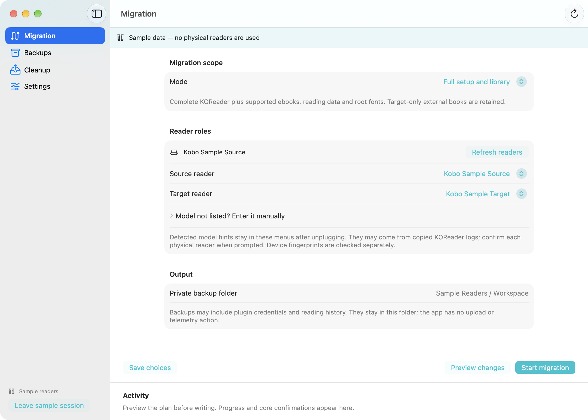
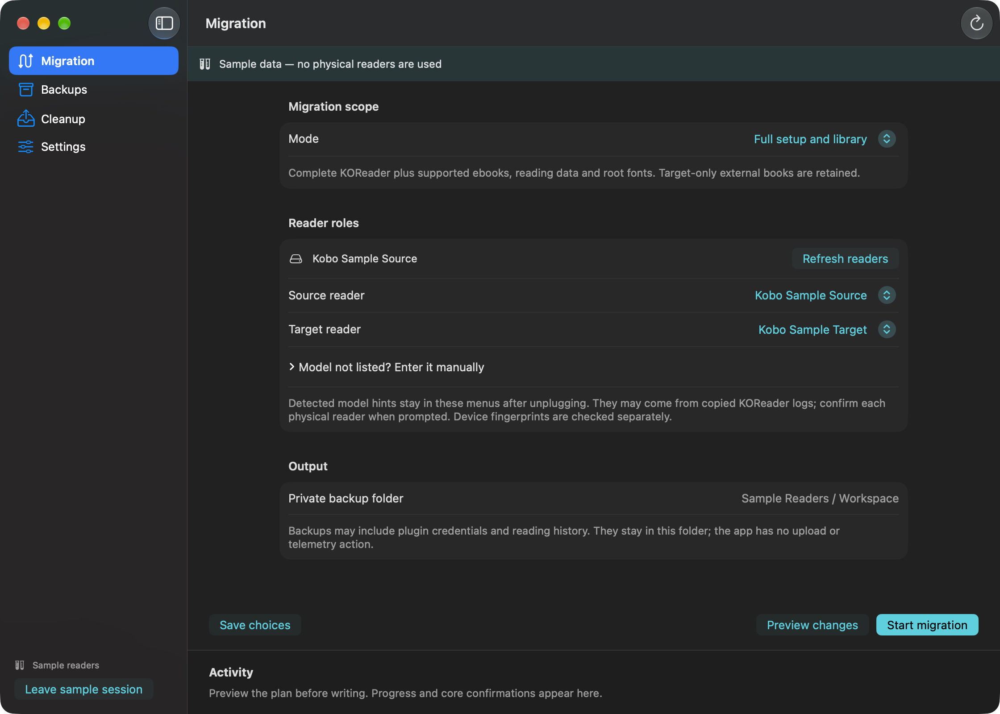
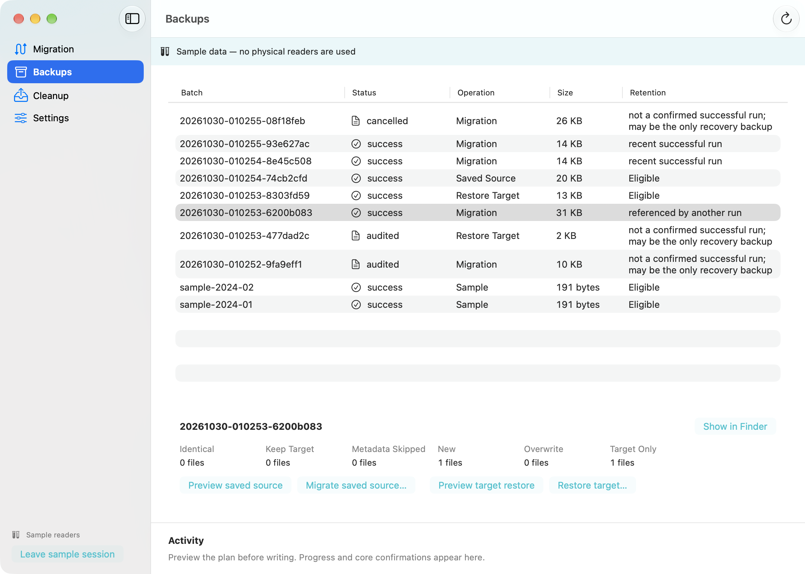
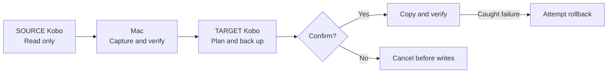

<h1 align="center">📚 KOReader Bridge</h1>

<p align="center">
  <strong>Bring your reading setup to your next device.</strong><br/>
  An independent, MIT-licensed native Mac app and offline CLI for migrating KOReader, supported ebooks, reading data and fonts.<br/>
  Currently supports Kobo → Kobo migration on macOS.<br/>
  Keep the original folder paths, preview changes and verify copied files.
</p>

<p align="center">
  <a href="#macos-app"></a>
  <a href="https://github.com/gh-slee/koreader-bridge/actions/workflows/tests.yml?query=branch%3Amain"></a>
  <a href="#tech-stack"></a>
  <a href="#requirements"></a>
  <a href="#tech-stack"></a>
  <a href="LICENSE"></a>
  <a href="#project-status-and-roadmap"></a>
</p>

<p align="center">
  <a href="#quick-start">Quick start</a> ·
  <a href="#cli-quick-start">CLI</a> ·
  <a href="#choose-a-mode">Modes</a> ·
  <a href="#device-support">Device support</a> ·
  <a href="#tech-stack">Tech stack</a> ·
  <a href="#language-support">Languages</a> ·
  <a href="#contributing">Contribute</a> ·
  <a href="https://github.com/gh-slee/koreader-bridge/issues">Report a bug</a>
</p>

> [!IMPORTANT]
> **Desktop development source: `1.1.0-dev.3`.** The native app is a local development build, not a notarized download. The published 1.0.0 release contains the CLI only. Device migration supports Kobo → Kobo on macOS. KOREADER has scoped Libra 2 → Clara 2E hardware confirmation, including normal use and progress persistence. FULL/LIBRARY remain available with automated coverage; successful physical copying for those modes and broader manual review remain incomplete. See the [validation record](ACCEPTANCE.md#validation-record-2026-10-22) and [release scope](ACCEPTANCE.md#first-stable-release-gates). A version in source is not proof of publication: use the [release list](https://github.com/gh-slee/koreader-bridge/releases) for published assets.

<a id="quick-start"></a>

## macOS app

The SwiftUI app uses the same migration engine as the CLI. You can configure a migration, inspect backup batches, reuse a saved source, restore a target snapshot or review cleanup. For connected readers, the app collects your choices in one review, prepares and verifies backups, then asks before writing. It checks device identity throughout and keeps the existing recovery protections.



### Build and launch

Requires **Apple Silicon, macOS 14+**, Apple command-line Swift tools and Python 3.9+ **for building**:

```bash
python3 scripts/build_macos_app.py --launch
```

The builder prints the path to the new `KOReader Bridge.app` and keeps earlier builds. On the first build, it downloads CPython and checks it against a pinned checksum. Later builds reuse that verified download. Python is included in the finished app, so you can launch it without configuring a shell, installing Python or connecting to a network or AI service.

- Migration: native model identification and USB identity checks, actual connected-reader source/target dropdowns, FULL/KOREADER/LIBRARY/AUDIT, preview, progress, consolidated review and graceful stop. Both readers can stay connected; sequential connection remains available. **Correct model…** opens a physical-model confirmation sheet for wrong/unknown identification. A correction cannot bypass identity checks; reconnecting requires a fresh selection.
- Migration review: for explicitly selected connected readers, confirm the roles, scope and KOReader compatibility in one sheet; keep the target identity by default (create one if absent). After verified backups, **Migrate now** authorizes writing; Return defaults to **Cancel migration**. Preview starts directly. Model exceptions, restore and deletion still require their own confirmations.
- Backups: reopen existing CLI output folders, inspect batches/differences, reuse sources and preview/perform exact target restoration.
- Cleanup: eligibility/protection preview; actual deletion requires exact typed confirmation.
- Settings: private output folder, saved workflow choices, interface/operation language and retention; unknown preference fields survive.
- Sample readers: opt-in synthetic devices and batches in a separate private workspace. No physical reader is accessed.

Choose English, Traditional Chinese or Simplified Chinese in **Settings → Language**. The interface changes immediately, and the app remembers your choice when you reopen it. New operations use that language; existing activity, external diagnostics, model names and paths keep their original text. The app stores preferences and default data in the current account's Application Support/KOReader Bridge. CLI defaults and data schemas are unchanged.

Local builds are **ad-hoc signed, not notarized**. Intel packaging and a public signed DMG are not implemented. See [Mac instructions](docs/MACOS.md), [architecture](docs/DESKTOP_ARCHITECTURE.md) and [security](SECURITY.md). The existing [v1.0.0 release](https://github.com/gh-slee/koreader-bridge/releases/tag/v1.0.0) remains the historical CLI distribution.

<details>
<summary>Dark appearance and backup browser (actual app; synthetic data)</summary>




</details>

## Why use it?

| | What you get |
| --- | --- |
| 📦 **Four migration modes** | Copy the entire supported setup, only KOReader, selected library content, or inspect without device writes. |
| 📂 **Original book locations** | `Books/Comics/issue.cbz` on SOURCE stays `Books/Comics/issue.cbz` on TARGET. EPUB, PDF, CBZ and other recognised formats follow the same rule. |
| 🔎 **A plan before changes** | Preview new, changed, identical and TARGET-only files. Size/SHA-256 comparisons skip identical payload files. |
| 🛟 **Backups and recovery** | Capture SOURCE, back up TARGET, verify copied bytes and attempt rollback on caught failures. Reuse saved SOURCE archives or restore a recorded TARGET snapshot. |
| 🧭 **Visible progress** | Phase timestamps, file/byte counts, transfer/hash speed, ETA and archive heartbeats show what the tool is doing. |
| 🔒 **Offline operation** | Python standard library plus macOS tools. No runtime downloads, telemetry, AI keys or LLM service. Private artifacts stay in local run folders. |

## Device support

KOReader Bridge currently supports **Kobo → Kobo migration only**. Support for other KOReader devices is planned; those devices cannot yet be used as migration sources or targets.

| Device migration | Status | Host and limits |
| --- | --- | --- |
| Kobo → Kobo | Implemented; broader manual acceptance pending | macOS, Python 3.9+. Confirm device roles and SOURCE build compatibility; no claim of universal Kobo model/plugin certification. |
| Routes involving Kindle | Planned research; unsupported | No Kindle detection, adapter or validated transfer policy is implemented. |
| Other KOReader device families | Future scope; unsupported | Platform selection, compatibility rules and validation are still to be defined. |

Additional device support is outside the first `1.0.0` milestone. Each new platform needs its own migration policy and tests before appearing as supported. See the [device-support roadmap](TRACKER.md#device-support-roadmap).

Current source uses **`koreader-bridge.py`**. Keep the adjacent `kobo-koreader-migrate.py` shared engine and the complete `locales/` directory; the old script remains a compatible command. Both entries use the same run root, locks and migration safeguards. Published RC1/3.x packages predate the new entry; use their original legacy commands and contents. The quick start below uses the current canonical entry. New source packages use `koreader-bridge-VERSION.zip`; historical packages retain their original names and bytes.

## CLI quick start

Use a published package from the [release list](https://github.com/gh-slee/koreader-bridge/releases), or clone the source. The commands below target version `1.0.0`; confirm that release and its named assets are listed before downloading. Start with offline checks and a dry run. Existing RC1/3.x packages retain their original filenames and instructions.

### 1. Get the project

When `v1.0.0` is listed, download `koreader-bridge-1.0.0.zip` and `SHA256SUMS` from that release into the same folder:

```bash
shasum -a 256 -c SHA256SUMS
unzip koreader-bridge-1.0.0.zip
cd koreader-bridge-1.0.0
python3 koreader-bridge.py --version
python3 scripts/check_locales.py
python3 koreader-bridge.py --self-test
```

Alternatively, clone the development source on `main`; use `--version` to identify the checked-out build:

```bash
git clone https://github.com/gh-slee/koreader-bridge.git
cd koreader-bridge
python3 --version
python3 koreader-bridge.py --version
python3 scripts/check_locales.py
python3 koreader-bridge.py --self-test
```

Python 3.9+ is required. No `pip install` is needed. You can also select `main` on GitHub and choose **Code > Download ZIP**. For current source, keep both Python entry/engine files and the complete `locales/` directory together; copying a single script is not a complete installation, even for English. In older published packages, use `kobo-koreader-migrate.py` with their original contents.

### 2. Explore without a Kobo

```bash
python3 koreader-bridge.py --help
python3 koreader-bridge.py --list-locales
python3 koreader-bridge.py --locale zh-Hant --preview-ui
```

These commands show help, list languages or display a static UI sample. They do not inspect devices or existing runs, and they create no migration logs or backups. Use `--dry-run` to inspect an actual device plan.

### 3. Preview a migration

The introductory commands use KOREADER, the mode with scoped hardware confirmation. For all modes and their validation limits, see the mode table below. Disconnect both Kobos first. Quit KOReader normally before connecting either device, then follow the SOURCE/TARGET prompts one device at a time:

```bash
python3 koreader-bridge.py --mode koreader --dry-run
```

A dry run reads both devices and creates local reports and locks. It leaves Kobo files unchanged and creates no ZIP backups. Review the plan, then rerun without `--dry-run` when you are ready. The tool calculates a fresh plan and asks for final confirmation:

```bash
python3 koreader-bridge.py --mode koreader
```

> [!NOTE]
> FULL includes supported books, reading data and root fonts by default. It retains TARGET-only library files outside `.adds/koreader`, but replaces the **entire KOReader directory** after backup. See [complete mode behavior](docs/USAGE.md#choose-a-mode) before approving writes.

Do not run as `sudo`. Keep backups until you have checked the result on TARGET. Cloning main obtains current development source, not a version-pinned release. Publishing the pre-release does not complete physical-device acceptance. SHA-256 checks detect mismatches; the checksum file is not a digital signature.

## Requirements

- **macOS** with `ditto`, `diskutil` and `sync`; **Python 3.9+**. No third-party Python packages.
- Kobo USB storage, connected **one device at a time**, with readable `.kobo/version` identity data.
- Existing SOURCE KOReader installation for FULL/KOREADER and enough Mac/TARGET space for staging, backups and copying.
- The operator confirms each physical model and SOURCE-build compatibility with TARGET.

[Full compatibility requirements](docs/USAGE.md#requirements-and-compatibility). Windows/Linux device migration is unsupported; Linux CI validates fixtures only.

## Choose a mode

| Mode | KOReader runtime | Books and reading data outside runtime | Root fonts |
| --- | --- | --- | --- |
| **FULL** | Replace entire tree | Included, preserving original paths | Included by default |
| **KOREADER** | Replace entire tree | Not copied | Not copied |
| **LIBRARY** | Retain installed runtime | Selected with flags/prompts | Optional |
| **AUDIT** | Inspect and plan only | Inspect selected content | Inspect if selected |

FULL is the default interactive mode. It retains TARGET-only library files outside `.adds/koreader`, but replaces the **entire KOReader tree**, including TARGET-only content within it, after backup. Different matching payload files are backed up and replaced; identical files are skipped.

KOREADER includes history/statistics stored inside `.adds/koreader`. Book-adjacent `.sdr` directories outside that tree are excluded, so progress, bookmarks and annotations stored there retain TARGET's existing data.

AUDIT and `--dry-run` make no Kobo writes, but create local reports/locks. [Complete modes and examples](docs/USAGE.md#choose-a-mode).

## How it works



SOURCE is ejected before TARGET is requested. Writes require final confirmation; caught failures attempt rollback while the original TARGET remains connected. [Step-by-step workflow](docs/USAGE.md#how-it-works) · [Recovery limits](docs/RECOVERY.md#recovery-boundaries).

## Tech stack

The native app uses **SwiftUI + AppKit + Foundation.Process** and bundled, pinned **CPython 3.13**. A bounded versioned JSON adapter calls the existing standard-library migration core. Source builds use `swiftc`; launch requires no package manager or shell runtime.


| Layer | Technology |
| --- | --- |
| 🐍 CLI | Python standard library, Python 3.9+ |
| 📦 Integrity | ZIP archives and SHA-256 manifests |
| 💾 macOS integration | `ditto`, `diskutil`, `sync`, OS-backed locks |
| 🌐 Records and locale data | UTF-8 JSON, read-only SQLite diagnostics |
| 🧪 Verification | `unittest`, synthetic fixtures, GitHub Actions |

[Implementation details and test commands](docs/DEVELOPMENT.md). GitHub CLI is optional maintainer tooling; the migration CLI has no network, telemetry or LLM runtime dependency.

## Language support

English (`en`), Traditional Chinese (`zh-Hant`) and Simplified Chinese (`zh-Hans`) are registered. **The published 1.0.0-rc.1 package and this source snapshot catalog the tool-owned runtime text**, with 371 entries per locale across migration, recovery, cleanup, safety errors, per-file progress, warnings and custom argument checks. Diagnostic logs and machine values stay English. External diagnostics, Python-generated parser/traceback text and safe startup errors when locale assets cannot load retain their original text. Keep `locales/` beside the script, even for English.

[Language selection and fallback](docs/USAGE.md#language-support). Final human wording review and end-to-end acceptance remain pending. Machine values such as statuses/modes and exact DELETE confirmations do not change with language; filenames and user data are preserved.

## Documentation

| Audience | Guide |
| --- | --- |
| Start migrating | [User guide: modes, books, metadata, fonts and all flags](docs/USAGE.md) |
| Manage backups | [Saved sources, TARGET restore, run records and cleanup](docs/RECOVERY.md) |
| Resolve problems | [Troubleshooting, recovery guidance and exit codes](docs/TROUBLESHOOTING.md) |
| Contribute code | [Architecture, technology, tests and coding agents](docs/DEVELOPMENT.md) |
| Maintain the repository | [Privacy checks, PR helper and release preparation](docs/MAINTAINING.md) |
| Review the project | [Contributing](CONTRIBUTING.md) · [Security](SECURITY.md) · [Changelog](CHANGELOG.md) |
| Test planned behavior | [Manual acceptance](ACCEPTANCE.md) · [Roadmap](TRACKER.md) |

## Safety and privacy

- Discovery uses recognised extensions; it does not guarantee every ebook or DRM-managed item is found. [Formats and exclusions](docs/USAGE.md#book-discovery).
- Reading metadata is copied, **not merged**. Whole-runtime copying also copies SOURCE settings; selective hardware-setting preservation is not implemented.
- Backups/reports can contain credentials, identifiers, reading history and filenames. Keep `runs/` private and share only synthetic/redacted reproductions.
- `--cleanup` alone previews eligibility. Deletion needs explicit run IDs and typed confirmation; it is never scheduled automatically. [Cleanup rules](docs/RECOVERY.md#backup-cleanup).

## Project status and roadmap

Version `1.0.0` establishes the documented CLI/schema compatibility baseline while retaining all four modes and the compatible legacy entry. Publication status and official assets are recorded on the [release list](https://github.com/gh-slee/koreader-bridge/releases). The earlier [RC1 pre-release](https://github.com/gh-slee/koreader-bridge/releases/tag/v1.0.0-rc.1) and historical 3.x releases remain unchanged.

Validation distinguishes device results from synthetic tests:

| Evidence | Confirmed scope | Remaining limits |
| --- | --- | --- |
| KOREADER on hardware | Kobo Libra 2 → Kobo Clara 2E using the 3.3.0-dev.6 package: whole-runtime transfer, full manifest verification, TARGET identity preservation and safe eject. The operator confirmed startup, opening an existing TARGET book, usual functions and progress persistence after reopening. | Confirmation covers the tested use; other models, builds and plugin combinations need their own checks. |
| CLI 1.0 runtime baseline | The merged CLI baseline passed 194 unit tests and six main CI jobs. A separate local rehearsal passed 42 synthetic cases across English, Traditional Chinese and Simplified Chinese; the exact-baseline source package passed 11 extracted checks with both entries. | Synthetic mount selection and safe eject were mocked. File-transfer checks do not verify reader rendering or hardware behavior. |
| FULL and LIBRARY | Synthetic transfer/recovery coverage; a physical FULL preview safely refused insufficient TARGET space before writes. | Successful physical copying with adequate capacity remains pending. |

See the [dated evidence and sources](ACCEPTANCE.md#validation-record-2026-10-22) and [remaining practical checks](ACCEPTANCE.md#remaining-practical-checks). Existing KOREADER device evidence remains valid for its tested build and scope. Broader recovery/cleanup acceptance and complete human translation review remain follow-up work. The [release criteria](ACCEPTANCE.md#first-stable-release-gates) require exact-artifact checks and explicit acceptance of these disclosed limits.

CI covers synthetic fixtures on macOS/Linux and a real macOS `ditto` round trip on temporary directories. It does not certify every device or replace the remaining manual acceptance checklists. The badge tracks push CI on main; review-branch checks are available on the corresponding PR. Detailed fixes and validation belong in CHANGELOG.md and docs/DEVELOPMENT.md.

Interrupted-transfer resume, exact library mirroring, content-assisted discovery, portable hardware settings, additional interface languages and non-Kobo device support remain planned work. [Current status and criteria](TRACKER.md) · [Automated evidence](docs/DEVELOPMENT.md#validation-and-release-status).

## Versioning

The first stable compatibility baseline is **`v1.0.0`**, following the published `v1.0.0-rc.1` and internal source candidates. This is a one-time numbering reset from the earlier `3.x` development series, continuing the existing tool. The baseline preserves all modes and documents the remaining validation limits; a stable version is not universal hardware or plugin certification.

Existing `v3.3.0-dev.*` tags and assets remain available unchanged. Version comparators sort `1.0.0` below the old `3.x` versions, so use the explicitly linked release and its notes rather than the numerically greatest tag. The eventual stable release will be explicitly selected as GitHub Latest when publication is approved. The CLI has no automatic updater.

The reset changes version metadata, not CLI flags, migration behavior, backup schemas or existing run directories. Supported older snapshots remain subject to the same schema, identity, integrity and path checks. See the [compatibility policy](docs/MAINTAINING.md#versioning-and-first-stable-release).

## Contributing

Contributions can include focused fixes, clearer documentation, synthetic regression tests or feedback on translated previews. Read [CONTRIBUTING.md](CONTRIBUTING.md). Coding agents should follow the shared [AGENTS.md](AGENTS.md) open format. Contributors are responsible for reviewing AI-assisted work; every runtime feature must work as standalone offline code.

Report reproducible bugs and feature requests through [GitHub Issues](https://github.com/gh-slee/koreader-bridge/issues). Follow [SECURITY.md](SECURITY.md) for sensitive findings; never attach books, raw backups or unredacted device data.

## Acknowledgments and license

Built for readers using [KOReader](https://github.com/koreader/koreader) on Kobo devices. Thanks to the KOReader community and this project's [contributors](https://github.com/gh-slee/koreader-bridge/graphs/contributors).

The tool uses the [MIT License](LICENSE). Its copyright notice retains the contributor name used when the project was called Kobo KOReader Migration. Device software, plugins, fonts and books keep their own licences. KOReader Bridge is an independent community project with no official affiliation to Kobo or KOReader.
