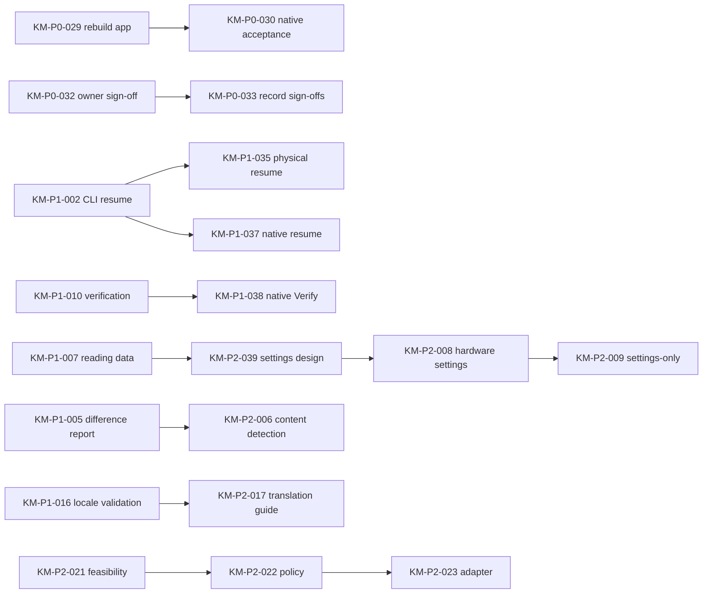

# End-to-end roadmap

`python3 scripts/tickets.py list` is the live status; this page explains the order.
[TRACKER.md](../TRACKER.md) stays the public feature tracker and the record of
acceptance status. Tickets track agent work. A ticket marked `done` means its code
is merged; the feature can still be Ready for test in TRACKER.md until the owner
signs it off.

## Where things stand (2026-11-06, main 1.1.0-dev.9)

- Done (code merged): the CLI baseline (KM-P1-901 to 909), locks and run status,
  difference report, saved-source restore, backup management, standalone
  verification with its extensions, CLI resume (RESUME_DESIGN.md slices 1-5),
  reading-data conflict report, three-language CLI, packaging, branding and the
  native app with bound readers, consolidated review and three languages.
- Waiting on the owner: about 18 of those features are Ready for test. Human
  acceptance, physical FULL/LIBRARY copying and physical resume are the main gaps.
- In progress: nothing. All feature branches are merged; there are no open PRs.
- Planned: native resume and Verify, hardware-settings policy, content detection,
  translation guide, then deferred mirror and non-Kobo work.

## Phases

| Phase | Outcome | Tickets |
|---|---|---|
| 1. Acceptance debt | Current main is rebuilt, tested by the owner and recorded | KM-P0-029, KM-P0-030, KM-P0-031, KM-P0-032, KM-P0-033, KM-P0-034, KM-P1-035 |
| 2. Parallel safety | Agents can run tests in parallel without shared runtime state | KM-P0-036 |
| 3. Native parity | The Mac app can verify and resume saved batches | KM-P1-038, KM-P1-037 |
| 4. Settings policy | Hardware settings survive migration; settings-only migration | KM-P2-039, KM-P2-008, KM-P2-009 |
| 5. Discovery and docs | Better book detection; translation guide | KM-P2-006, KM-P2-017 |
| 6. Distribution | Decide on and ship a public Mac build | KM-P2-040 |
| 7. Deferred | Exact mirror; non-Kobo devices | KM-P2-004, KM-P2-021, KM-P2-022, KM-P2-023 |

KM-P2-012 is an ongoing hygiene umbrella; file concrete child tickets under it.

## Dependencies

Owner-gated work in the graph (KM-P0-030 to 034, KM-P0-036, KM-P1-035,
KM-P1-037, KM-P2-008 and later) cannot be claimed until the owner records
`gate_approval`.

## Parallel lanes

Tickets in different lanes share no exclusive resource, so different agents can
work them at the same time. Work inside a lane is sequential.

| Lane | Resource | Now | Next |
|---|---|---|---|
| Native build | `macos-gui` | KM-P0-029 | KM-P0-030 (owner) |
| Native features | `native-app`, `desktop-ipc`, `native-locales` | KM-P1-038 | KM-P1-037 (gated) |
| Settings design | none (new design doc) | KM-P2-039 | KM-P2-008 (gated) |
| Engine scan | `engine-scan`, `cli-locales` | KM-P2-006 | — |
| Contributor docs | `contributor-docs` | KM-P2-017 | — |
| Acceptance records | `acceptance-docs` | waits on KM-P0-032 | KM-P0-033 |
| Physical readers | `physical-kobo` | owner only | KM-P0-034, KM-P1-035 |
| Lock isolation | `engine-locks` | gated | KM-P0-036 |

Suggested split today:

- **Frontier agent:** KM-P1-038 (native Verify) now, so KM-P1-037 can follow in the
  same lane once approved. Review high-risk PRs from the other lanes.
- **Standard agent 1:** KM-P0-029 on a macOS host with GUI access, then KM-P2-006.
- **Standard agent 2:** KM-P2-039 (design only).
- **Any-tier agent:** KM-P2-017, then KM-P0-033 when the owner's sign-off arrives.

KM-P2-006 and KM-P2-008 both add CLI catalog entries (`cli-locales`), so they run
one after the other. Every runtime PR also bumps the version and CHANGELOG; rebase
and re-bump at the end rather than locking those files.

## Owner actions that unlock more parallel work

1. Run the native acceptance (KM-P0-030) once KM-P0-029 has a fresh build, and work
   through the consolidated sign-off sheet (KM-P0-032). This unlocks KM-P0-033.
2. Choose an option for the lock-directory ticket (KM-P0-036) and record approval.
3. Approve native resume (KM-P1-037) so it can follow KM-P1-038 in the native lane.
4. Provide a capacity-sufficient TARGET and written scope for physical FULL/LIBRARY
   (KM-P0-034) and, optionally, physical resume (KM-P1-035).
5. After reviewing the KM-P2-039 design, approve KM-P2-008.
6. Decide on public distribution (KM-P2-040).

## Priority changes and mapping

TRACKER.md uses P1-P3; tickets use P0-P2 and follow the work order agreed on
2026-11-02. Ticket IDs keep the old KM number where one existed
(`KM-007` → `KM-P1-007`). TRACKER.md priorities are not changed by this file.

| Old item | Ticket | Change and reason |
|---|---|---|
| BASE-001 to 009 | KM-P1-901 to 909 | Done baseline, kept for dependencies |
| KM-001, 003, 005, 010, 011, 013-016, 018, 025-028 | same number, P1 | Done (code merged); acceptance in KM-P0-032 |
| KM-002 | KM-P1-002 (done) + KM-P1-037 | TRACKER P2 → P1: CLI slices merged; desktop slice 6 split out |
| KM-007 | KM-P1-007 | TRACKER P2 → P1 in the work order; done (code merged) |
| KM-019, 020, 024 | same number, P2 | Done (code merged); link and wording review in KM-P0-032 |
| KM-004 | KM-P2-004 | TRACKER P3 → P2 backlog: the ticket scale has no P3; still deferred |
| KM-006, 008, 009, 017 | same number, P2 | Unchanged; KM-008/009 now depend on design ticket KM-P2-039 |
| KM-012 | KM-P2-012 | Ongoing umbrella, backlog |
| KM-021, 022, 023 | same number, P2 | Deferred until Kobo acceptance is stable |
| Work order P0-1 rebuild | KM-P0-029 | New |
| Work order P0-2 native acceptance | KM-P0-030 | New |
| Work order P0-3 KM-010 acceptance | KM-P0-031 | New |
| Work order P0-4 sign-off sheet | KM-P0-032, KM-P0-033 | Sheet prepared privately; sign-off and recording are tickets |
| Work order P0-5 physical FULL/LIBRARY | KM-P0-034 | New |
| KM-002 physical checklist | KM-P1-035 | New |
| Work order P1-3 native Verify | KM-P1-038 | New |
| Work order P2-6 public distribution | KM-P2-040 | New decision ticket |
| Kit isolation requirement | KM-P0-036 | New; frontier and owner-gated because it touches lock behavior |
